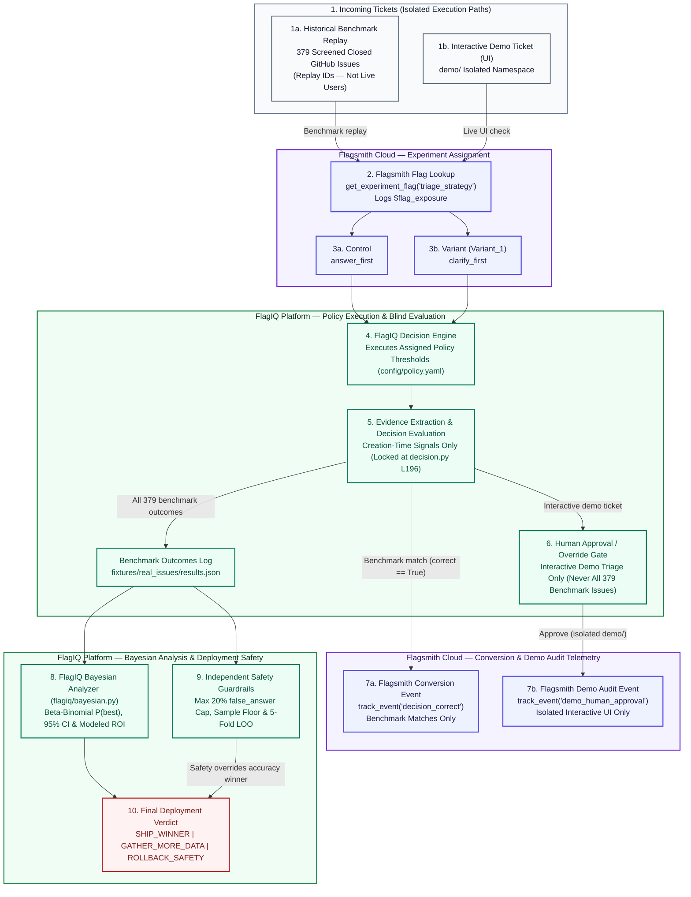
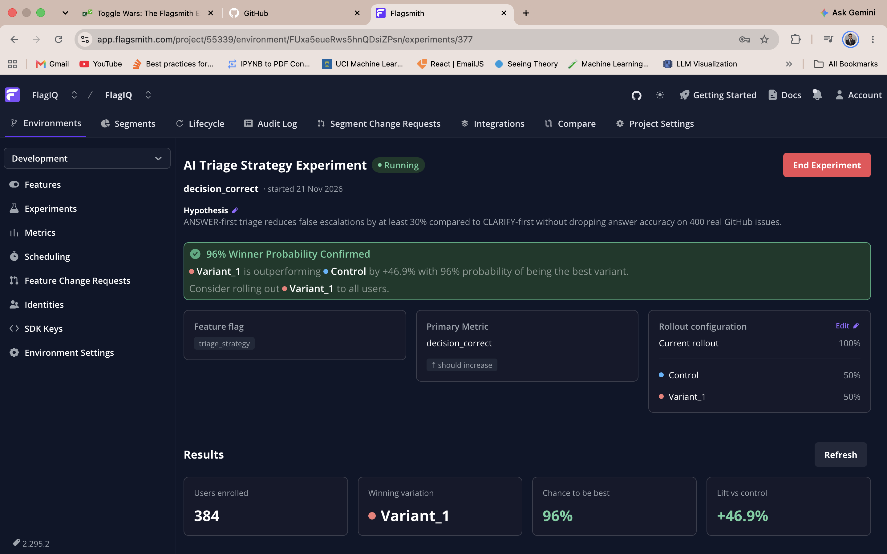
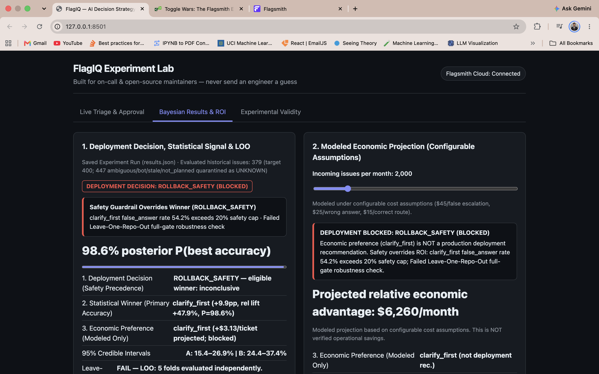

# FlagIQ 🚩

> **"Don't deploy an AI decision strategy because it looks intelligent — or even because a single accuracy metric wins. Experiment via Flagsmith, verify downstream error guardrails, and ship only when safety passes."**

FlagIQ is an **evidence-driven AI decision strategy A/B testing & guardrail platform** built for **Toggle Wars 2026 (WeMakeDevs × Flagsmith, Track 1 — Test Something Real)**.

> **Methodology Transparency Note:** FlagIQ intentionally uses **deterministic, zero-LLM evidence scoring** (regex stack-trace/repro extraction, normalized failure signatures, and temporally isolated token Jaccard similarity) rather than foundation-model inference. This eliminates LLM latency, cost, and stochastic drift so metric differences are attributable to the Flagsmith-assigned policy thresholds—while keeping the exact Flagsmith harness ready to wrap LLM prompt variants in production.

---

## Judge Quick-Start (30-Second Review)

- **Live Deployed App URL:** https://flagiq-f0rn.onrender.com *(Tab 1 runs live against Flagsmith Cloud on sample/custom tickets; full 379-issue dataset & locally scraped JSONs live locally via `.venv/bin/python app.py`)*
- **3-Minute Demo Video URL:** *Pending YouTube unlisted upload*

### 3-Command Local Verification
```bash
bash setup.sh                                    # 1. Create .venv, install requirements.txt, init .env, run 33 tests
.venv/bin/python scripts/validate_experiment.py  # 2. Prove blind evaluation, zero post-close leakage & temporal guard
.venv/bin/python app.py                          # 3. Open http://127.0.0.1:8501 & test 1-Click Judge Demo Scenarios
```
*(Fresh clones without scraped `fixtures/real_issues/*.json` evaluate against the 5 built-in sample tickets until you run the scraper and live experiment pipeline below.)*

### Exact Flagsmith & Code Touchpoints
| Capability | File & Line | What Happens |
|---|---|---|
| Live experiment flag & exposure | [`app.py#L120`](app.py#L120), [`scripts/run_experiment.py#L201`](scripts/run_experiment.py#L201) | `fs.get_experiment_flag("triage_strategy", identifier=identity)` assigns variant & records `$flag_exposure` |
| Occurrence conversion event | [`scripts/run_experiment.py#L228`](scripts/run_experiment.py#L228) | `fs.track_event("decision_correct", identifier=identity)` emitted **only** on benchmark matches (`result.correct == True`) |
| Isolated demo human approval | [`app.py#L1417`](app.py#L1417) | Interactive `demo/` evaluations emit `"demo_human_approval"` separately — never contaminating `"decision_correct"` |
| Explicit event buffer flush | [`app.py#L1419`](app.py#L1419), [`scripts/run_experiment.py#L401`](scripts/run_experiment.py#L401) | `fs.flush_events()` drains buffered events before exit (`enable_events=True`) |
| Blind decision & outcome boundary | [`flagiq/decision.py#L196`](flagiq/decision.py#L196), [`flagiq/decision.py#L226`](flagiq/decision.py#L226) | `decision` locks strictly from creation-time signals before `real_resolution` or post-close fields are accessed |
| Deployment Eligibility Gate | [`flagiq/bayesian.py#L190`](flagiq/bayesian.py#L190), [`app.py#L185`](app.py#L185) | Separates Deployment Decision (`ROLLBACK_SAFETY` priority), Statistical Winner, Modeled Economic Preference, and 5-fold LOO checks |

---

## FlagIQ × Flagsmith Architecture



Flagsmith controls experiment assignment and captures exposure and conversion events. FlagIQ executes the competing triage strategies, evaluates experimental outcomes, performs Bayesian analysis and applies independent safety guardrails before recommending deployment.

- **Flagsmith Cloud Responsibilities:** Serves randomized multivariate `triage_strategy` assignments (`Control: answer_first`, `Variant: clarify_first`), logs `$flag_exposure`, and captures `"decision_correct"` (`occurrence` metric on historical benchmark matches only) alongside isolated `"demo_human_approval"` UI audit events.
- **FlagIQ Platform Responsibilities:** Enforces zero post-close leakage (`flagiq/decision.py`), keeps interactive UI human approvals (`demo/` + Step 6 Human Review Gate) strictly isolated from the 379-issue historical benchmark replay (`scripts/run_experiment.py`), computes Beta-Binomial posteriors and modeled economics (`flagiq/bayesian.py`), and enforces independent safety guardrails (`ROLLBACK_SAFETY` when `false_answer > 20%`).

---

## Methodology & Experimental Limitations (Read First)

Before interpreting the experiment numbers below, note four structural boundaries of this evaluation:

1. **Imperfect Ground Truth (50-Ticket Human Audit):** Automated benchmark labels are derived deterministically from historical GitHub issue metadata and resolution signals. A stratified 50-ticket human audit (sampled by [`scripts/scrape_github_issues.py`](scripts/scrape_github_issues.py)) found **`42/50` (`84%`) strict agreement overall** (`ESCALATE`: `36/37`, `DUPLICATE`: `3/3`), with weak precision in **`ANSWER` (`3/10` strictly confirmed)**. Results must be interpreted as provisional, particularly for `ANSWER` decisions.
2. **Mutable GitHub Issue Bodies:** GitHub's REST `/issues` endpoint returns the latest edited issue `body` rather than an immutable creation-time snapshot (`audit_sample_50.json` tracks `body_edit_marker` hints for manual inspection).
3. **Historical Replay ≠ Prospective Live Users:** All **`379` screened historical GitHub issues** (from a `400`-issue target after excluding **`447`** ambiguous/bot/stale/`not_planned` issues) are historical tickets replayed deterministically through Flagsmith — **not** 379 live end-users. Offline `--local-preview` runs are counterfactual comparisons, not live paired-user experiments.
4. **Statistical Winner ≠ Deployment Eligibility:** Passing all six pipeline validity checks guarantees causal hygiene (no post-close leakage, balanced covariates, temporal isolation), not ground-truth perfection — and winning on primary accuracy (`decision_correct`) never overrides operational error caps (`max_false_answer_rate = 20%` in [`config/policy.yaml`](config/policy.yaml)).

---

## Why Flagsmith Is Essential (Not a Superficial Toggle)

| Static Config / Hardcoded Thresholds | FlagIQ Closed-Loop Flagsmith Architecture |
|---|---|
| One hardcoded policy runs blindly forever; nobody measures whether guessing hurts users or engineers. | **Dynamic Policy Routing:** Every ticket hits `get_experiment_flag("triage_strategy")` to split screened historical issues 50/50 between `answer_first` and `clarify_first`. |
| Manual scripts cannot tie individual decisions back to randomized exposure cohorts. | **Live Conversion Ingestion:** `track_event("decision_correct")` feeds Flagsmith's Bayesian warehouse alongside local `evaluate_experiment()` ([`flagiq/bayesian.py`](flagiq/bayesian.py)). |
| Changing or rolling back a failing policy requires editing YAML/code and redeploying. | **Safety-Gated Control Plane:** Flagsmith reports primary statistical lift (`96%`), while FlagIQ blocks unsafe deployment (`ROLLBACK_SAFETY`) when false answers breach `20%`. |

## Target User & Human Outcome

Built for **open-source maintainers and on-call engineering leads** managing noisy issue queues:
- **False Escalations (`$45/ticket` modeled assumption):** Routing routine questions to senior engineers burns sprint capacity.
- **False Answers (`$25/ticket` modeled assumption):** Guessing on unresolved bugs without reproduction proof misleads users and erodes trust.

FlagIQ puts **fast-deflection (`answer_first`)** and **evidence-gated (`clarify_first` — refuse to guess without stack traces/repro proof)** behind Flagsmith's multivariate `triage_strategy` flag across **379 screened historical GitHub issues** (`400`-issue target; **`447`** ambiguous closures excluded as `UNKNOWN`), separating statistical accuracy from deployment safety.

---

## Experiment Results & Reconciliation (Nov 26 Run)

### 1. Flagsmith Cloud ↔ Local Reconciliation (`As of 26 Nov 2026, 13:41 UTC`)


> **Reconciliation Note:** The running Flagsmith Cloud total (`385`) reflects the **`379` screened historical issues** plus **`5` pre-run smoke probes (`smoke/check#1..5`)** plus **`1` interactive UI test exposure (`demo/...`)** verified via `app.py` (`+1` `Variant_1` exposure, `0` `decision_correct` conversions because interactive `demo/` checks never emit benchmark conversions). The Cloud Hypothesis was updated cleanly in-place without resetting experiment data. *(Note: the earlier screenshot above was captured at `12:38 UTC` with `384` enrolled before the hypothesis edit and interactive UI test.)*

| Arm | Screened Historical Dataset (`379` issues) | Smoke (`smoke/check#1..5`) + `1` UI Demo | Expected Flagsmith Total | Flagsmith Cloud UI |
|---|---|---|---|---|
| `answer_first` (`Control`) | `39 / 189` (`20.6%`) | `+1` exp, `+1` conv | `190` (`21.05%`) | **`190`** exposures, **`21.1%`** Occ. Rate |
| `clarify_first` (`Variant_1`) | `58 / 190` (`30.5%`) | `+5` exp (`4` smoke + `1` `demo/`), `+2` conv | `195` (`30.77%`) | **`195`** exposures, **`30.8%`** Occ. Rate |
| **Combined** | `97 / 379` | `+6` exp, `+3` conv | **`385`** enrolled | **`385`** enrolled, **`+46.2%`** lift, **`96%`** win prob |

### 2. Three Strictly Separated Decisions


1. **Statistical Accuracy Winner — `clarify_first` (`30.5%` vs `20.6%`):**
   - Local Beta-Binomial **`P(clarify_first > answer_first) = 98.6%`** (`+9.9pp`, `+47.9%` relative lift; 95% CIs `[15.4%, 26.9%]` vs `[24.4%, 37.4%]`; Flagsmith Cloud `96%`, CI `[-4.6%, 96.9%]`).
2. **Modeled Economic Preference — `clarify_first` (`-$12.53` vs `-$15.66`/ticket modeled):**
   - Net modeled values on the 379-issue benchmark are **`-$2,960` / `189` tickets** (`answer_first`) vs **`-$2,380` / `190` tickets** (`clarify_first`), a `+$3.13/issue` relative margin → **`Projected relative economic advantage: $6,260/month`** at `2,000` issues/month under configured cost assumptions (`$45` FE, `$25` FA, `$15` correct). **This is a modeled projection, not verified operational savings, and not a deployment recommendation.**
3. **Actual Safety & Deployment Decision — `ROLLBACK_SAFETY` (`BLOCKED`):**
   - **Both strategies breach the configured `max_false_answer_rate = 20%` safety cap** (`clarify_first`: **`54.2%`** false-answer rate, `5.8%` false-escalation rate; `answer_first`: **`67.2%`** false-answer rate, `2.1%` false-escalation rate). FlagIQ blocks rollout (`winning_variant = inconclusive`); safety always overrides accuracy and modeled ROI.

### 3. Independent 5-Fold Leave-One-Repo-Out (LOO) Evaluation (`FAIL`)
`LOO: 5 folds evaluated independently. Statistical preference is not robust at the configured 90% threshold in every fold. Safety eligibility fails across folds.`
All **five** repository-exclusion folds independently fail safety eligibility (`47.6%–60.1%` false-answer rate vs `20%` max):
- Excluding `facebook/react` (`n=146, 153`): `P=98.9%`, `false_answer=60.1%` → `ROLLBACK_SAFETY`
- Excluding `flagsmith/flagsmith` (`n=157, 162`): `P=98.5%`, `false_answer=50.0%` → `ROLLBACK_SAFETY`
- Excluding `microsoft/vscode` (`n=152, 147`): `P=100.0%`, `false_answer=47.6%` → `ROLLBACK_SAFETY`
- Excluding `python/cpython` (`n=143, 136`): **`P=74.4%`** (`<90%`), `false_answer=58.1%` → `ROLLBACK_SAFETY`
- Excluding `vercel/next.js` (`n=158, 162`): **`P=87.9%`** (`<90%`), `false_answer=55.6%` → `ROLLBACK_SAFETY`

### 4. Stratified Complexity Results & Human Audit Caveats


- **Six automated validity checks pass** ([`scripts/validate_experiment.py`](scripts/validate_experiment.py)): consistent identity hashing, covariate balance, blind evaluation (`decision` locked at [`flagiq/decision.py#L196`](flagiq/decision.py#L196) before post-close access at [`L226`](flagiq/decision.py#L226)), confidence blindness, reproducibility, and temporal peer isolation (`peer.created_at < issue.created_at`) + `UNKNOWN` exclusion. **Passing these checks does not imply perfect ground truth.**
- **50-Ticket Stratified Human Audit Breakdown:** **`42/50` (`84%`) strict agreement overall** — `ESCALATE` **`36/37`**, `DUPLICATE` **`3/3`**, **`ANSWER` `3/10` strictly confirmed**.
- **Creation-Time Complexity Quartiles (`app.py` Q1–Q4):**
  - `Q1 (Low Context)`: `answer_first` **`23.3% (n=73)`** vs `clarify_first` **`14.6% (n=96)`** *(reverses overall accuracy ranking)*
  - `Q2 (Medium-Low)`: `answer_first` `10.0% (n=10)` vs `clarify_first` `50.0% (n=14)`
  - `Q3 (Medium-High)`: `answer_first` `19.8% (n=106)` vs `clarify_first` `46.2% (n=80)`
  - Overall preference does not hold across every complexity segment.

<details>
<summary>Evidence Gallery — All Captured Flagsmith Cloud & FlagIQ Screenshots (assets/)</summary>

| Artifact | Scope |
|---|---|
| [`assets/win_probability.png`](assets/win_probability.png) | Flagsmith Cloud summary (`384` enrolled, `Variant_1`, `96%`, `+46.9%` lift) |
| [`assets/flagsmith_analysis_conversions.png`](assets/flagsmith_analysis_conversions.png) | Flagsmith `Analysis` table (`190` / `21.1%` vs `194` / `30.9%`) & conversions |
| [`assets/flagsmith_exposures_enrollment.png`](assets/flagsmith_exposures_enrollment.png) | Flagsmith `Enrollment over time` tooltip (`190 + 194 = 384`) |
| [`assets/flagiq_live_triage.png`](assets/flagiq_live_triage.png) | Tab 1: Live Flagsmith routing, creation-time evidence & isolated `demo/` gate |
| [`assets/flagiq_dashboard_verdict_roi.png`](assets/flagiq_dashboard_verdict_roi.png) | Tab 2: `ROLLBACK_SAFETY`, 3 separated decisions, `LOO: FAIL`, modeled ROI |
| [`assets/flagiq_loo_audit_variants.png`](assets/flagiq_loo_audit_variants.png) | Tab 2: All 5 LOO folds, human-audit warning & variant accuracy/error cards |
| [`assets/flagiq_comparison_outcomes.png`](assets/flagiq_comparison_outcomes.png) | Tab 2: SVG comparison bars & per-issue outcomes table |
| [`assets/flagiq_experimental_validity.png`](assets/flagiq_experimental_validity.png) | Tab 3: Causal validity checks, audit warning & Q1–Q4 breakdown |
| [`assets/hackathon_rules_head_start.png`](assets/hackathon_rules_head_start.png) | Official Toggle Wars Rule 04 head-start & eligibility capture |

</details>

---

## Architecture Safeguards

1. **Strict `UNKNOWN` Exclusion ([`scripts/scrape_github_issues.py`](scripts/scrape_github_issues.py)):** Checks `merged_at` strictly on PRs, quarantines `stale[bot]` / `not_planned` / unmerged closures to `excluded_unknown.json` (`447` excluded), and exports `audit_sample_50.json` for spot-checking.
2. **LOO Sample Floor ([`flagiq/bayesian.py`](flagiq/bayesian.py)):** Each 4-repo LOO fold applies a configured equal-weight floor of `n >= 80/arm` (`int(100 × (K - 1)/K)`); our `379`-issue screened dataset yields `136–162/arm` per fold, clearing `80/arm` across all 5 folds.
3. **Demo vs. Benchmark Isolation ([`app.py#L1417`](app.py#L1417)):** Interactive UI clicks force `demo/` identifiers and emit `"demo_human_approval"` separately so judge tests never pollute `"decision_correct"`.
4. **Crash Recovery & Reconciliation ([`scripts/run_experiment.py`](scripts/run_experiment.py)):** `--resume` commits `results.json` atomically before `processed.json`; remote `$flag_exposure` delivery is at-least-once on hard `SIGKILL` before disk commit and reconciled post-run against Flagsmith Cloud counts (`379` benchmark + `5` smoke probes + `1` UI `demo/` evaluation = `385`).

---

## Development Timeline & Eligibility Disclosure

Per official Toggle Wars 2026 Rule 04 ([`wemakedevs.org/hackathons/flagsmith/rules`](https://www.wemakedevs.org/hackathons/flagsmith/rules), archived in [`assets/hackathon_rules_head_start.png`](assets/hackathon_rules_head_start.png)): *"You can get a head start: try Flagsmith and start building your idea with it before the hackathon begins. That's allowed. Submit by the deadline like everyone else."* Initial project scaffolding and deterministic heuristic design were prepared prior to kickoff, while live GitHub scraping, 50-issue human auditing, live Flagsmith Cloud experimentation, statistical reconciliation, validation, and demo preparation are executed transparently during the Nov 26–29 hackathon window.

---

## Full Experiment Reproduction

```bash
git clone https://github.com/CodeUltr0n/FlagIQ
cd FlagIQ
bash setup.sh                                         # installs dependencies into .venv, prepares .env, runs 33 tests
# Fill GITHUB_TOKEN and FLAGSMITH_ENV_KEY in .env

.venv/bin/python scripts/smoke_test_flagsmith.py      # 1. Verify live Flagsmith exposure & conversion ingestion
.venv/bin/python scripts/scrape_github_issues.py      # 2. Scrape 400-target closed issues (379 screened, 447 excluded)
.venv/bin/python scripts/run_experiment.py --local-preview # 3. Offline counterfactual comparison (not live paired users)
.venv/bin/python scripts/validate_experiment.py       # 4. Verify zero leakage, balance & temporal isolation
.venv/bin/python scripts/run_experiment.py            # 5. Run live Flagsmith A/B experiment on screened dataset
.venv/bin/python scripts/validate_experiment.py --post # 6. Stratified Q1-Q4 & 5-fold LOO sensitivity audit
.venv/bin/python scripts/check_win_probability.py     # 7. Deployment Eligibility Gate & reconciliation
.venv/bin/python app.py                               # 8. Launch local FlagIQ Web Workbench (:8501)
```

---

## Builder
**Ketan Chokkara** · Solo · AI Engineer & Data Scientist  
Toggle Wars 2026 · Track 1: Test Something Real · [github.com/CodeUltr0n/FlagIQ](https://github.com/CodeUltr0n/FlagIQ)
