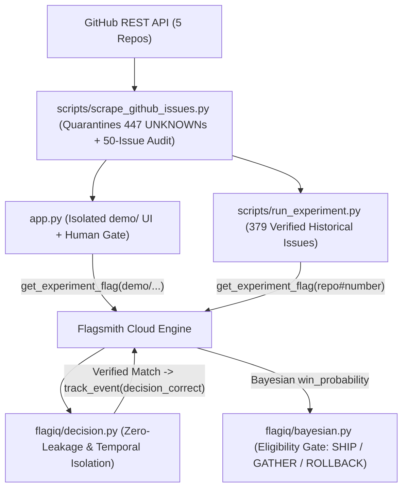
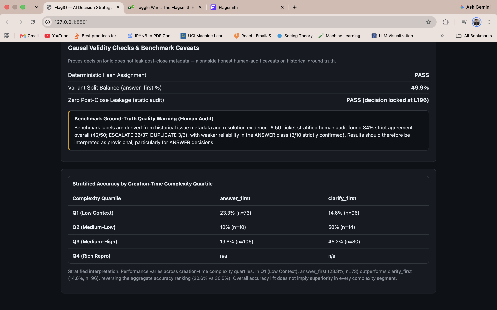

# FlagIQ 🚩

> **"On-call and open-source maintainers shouldn't gamble on unverified triage policies. FlagIQ proves which decision policy saves senior engineering hours without guessing — using Flagsmith Experimentation."**

FlagIQ is an **evidence-driven automated decision strategy testing & guardrail platform** built for **Toggle Wars 2026 (WeMakeDevs × Flagsmith, Track 1 — Test Something Real)**.

> **Methodology Transparency Note:** FlagIQ intentionally uses **deterministic, zero-LLM evidence scoring** (regex stack-trace/repro extraction, normalized failure signatures, and temporally isolated token Jaccard similarity) rather than foundation-model inference. This eliminates LLM latency, cost, and stochastic drift so every metric difference is 100% attributable to the Flagsmith-assigned policy thresholds—while keeping the exact Flagsmith harness ready to wrap LLM prompt variants in production.

---

## Judge Quick-Start (30-Second Review)

- **Live Deployed App URL:** `[Add Render URL after deploy]` *(run locally in 1s via `python3 app.py`)*
- **3-Minute Demo Video URL:** `[Add YouTube Unlisted URL]`

### 3-Command Local Verification
```bash
python3 -m pytest tests/ -v                  # 1. Run 33/33 unit, Bayesian, temporal & leakage tests
python3 scripts/validate_experiment.py       # 2. Prove zero post-close leakage & temporal isolation
python3 app.py                               # 3. Open http://127.0.0.1:8501 & click 1-Click Judge Demo Scenarios
```

### Exact Flagsmith Touchpoints
| Capability | File & Line | What Happens |
|---|---|---|
| Live experiment flag & exposure | [`app.py#L120`](file:///Users/chokkaraketankumar/Desktop/Toggle/app.py#L120), [`scripts/run_experiment.py#L201`](file:///Users/chokkaraketankumar/Desktop/Toggle/scripts/run_experiment.py#L201) | `fs.get_experiment_flag("triage_strategy", identifier=identity)` assigns variant & records `$flag_exposure` |
| Occurrence conversion event | [`scripts/run_experiment.py#L228`](file:///Users/chokkaraketankumar/Desktop/Toggle/scripts/run_experiment.py#L228) | `fs.track_event("decision_correct", identifier=identity)` emitted **only** on verified benchmark matches (`result.correct == True`) |
| Isolated demo human approval | [`app.py#L1345`](file:///Users/chokkaraketankumar/Desktop/Toggle/app.py#L1345) | Interactive `demo/` evaluations emit `"demo_human_approval"` separately — never contaminating `"decision_correct"` |
| Explicit event buffer flush | [`app.py#L1347`](file:///Users/chokkaraketankumar/Desktop/Toggle/app.py#L1347), [`scripts/run_experiment.py#L401`](file:///Users/chokkaraketankumar/Desktop/Toggle/scripts/run_experiment.py#L401) | `fs.flush_events()` drains buffered events before exit (`enable_events=True`) |
| Deployment Eligibility Gate | [`flagiq/bayesian.py#L190`](file:///Users/chokkaraketankumar/Desktop/Toggle/flagiq/bayesian.py#L190), [`app.py#L185`](file:///Users/chokkaraketankumar/Desktop/Toggle/app.py#L185) | Separately reports Deployment Decision (`ROLLBACK_SAFETY` priority), Statistical Leader, Modeled Economic Preference, and independent 5-fold LOO checks |

---

## Why Flagsmith Is Essential (Not a Superficial Toggle)

| Static Config / Hardcoded Thresholds | FlagIQ Closed-Loop Flagsmith Architecture |
|---|---|
| One hardcoded policy runs blindly forever; nobody measures whether guessing hurts users or engineers. | **Dynamic Policy Routing:** Every ticket hits `get_experiment_flag("triage_strategy")` to split real issues 50/50 between `answer_first` and `clarify_first`. |
| Manual scripts cannot tie individual decisions back to randomized exposure cohorts. | **Live Conversion Ingestion:** `track_event("decision_correct")` feeds Flagsmith's Bayesian warehouse and local `evaluate_experiment()` posterior (`flagiq/bayesian.py`). |
| Changing or rolling back a failing policy requires editing YAML/code and redeploying. | **Zero-Redeploy Adaptation:** Promoting `SHIP_WINNER` or triggering `ROLLBACK_SAFETY` in Flagsmith Cloud updates `app.py` routing immediately on the next ticket. |

---

## Target User & Human Outcome

Built specifically for **open-source maintainers and on-call engineering leads** managing noisy issue queues:
- **False Escalations (`$45/ticket`):** Routing routine configuration questions straight to senior engineers burns sprint capacity.
- **False Answers (`$25/ticket`):** Guessing on deep bugs without reproduction proof misleads users and damages repo trust.

FlagIQ puts **fast-deflection (`answer_first`)** and **evidence-gated (`clarify_first` — refuse to guess without stack traces/repro proof)** behind a single Flagsmith multivariate flag, tests both across **379 verified historical GitHub issues** (from a 400-issue target after quarantining **447** ambiguous/bot/stale/`not_planned` closures as `UNKNOWN`), enforces safety circuit-breakers (`false_answer <= 20%`), and lets Flagsmith's Bayesian engine and FlagIQ's safety gate govern deployment eligibility.

---

## Architecture (Closed-Loop Flagsmith Flow)



---

## Experiment Results & Honest Limitations (Nov 26 Run)

> **Experimental Scope & Framing:** The benchmark evaluates **379 historical closed GitHub issues** replayed deterministically through live Flagsmith Cloud flag assignment — **not** 379 live production end-users. The paired local `--local-preview` run is an offline counterfactual comparison and **not** a live paired-user experiment. `400` issues was the scraping target; **447** stale, bot-closed, or `not_planned` issues were quarantined to `excluded_unknown.json` (`vercel/next.js` yielded `59/80` verified issues within the scan cap), leaving **379** evaluated historical issues.

### Flagsmith Cloud ↔ Local Reconciliation (`As of 26 Nov 2026, 12:38 UTC`)


> **Flagsmith Cloud Hypothesis Text Note:** The running Flagsmith Cloud UI header retains the pre-launch hypothesis wording (*"...reduce false escalations... on 400 real GitHub issues"*). The live experiment was kept intact without resetting or restarting; actual evaluation covers **379 verified historical issues** on primary metric `decision_correct` paired with FlagIQ's safety guardrails (`ROLLBACK_SAFETY`).

| Arm | Local Benchmark (379 issues) | Pre-Run Smoke (`smoke/check#1..5`) | Expected Flagsmith Total | Flagsmith Cloud UI |
|---|---|---|---|---|
| `answer_first` (`Control`) | `39 / 189` (`20.6%`) | `+1` exp, `+1` conv | `190` (`21.05%`) | **`190`** exposures, **`21.1%`** Occ. Rate |
| `clarify_first` (`Variant_1`) | `58 / 190` (`30.5%`) | `+4` exp, `+2` conv | `194` (`30.93%`) | **`194`** exposures, **`30.9%`** Occ. Rate |
| **Combined** | `97 / 379` | `+5` exp, `+3` conv | **`384`** enrolled | **`384`** enrolled, **`+46.9%`** lift, **`96%`** win prob |

### Three Separated Decisions (Safety Takes Strict Precedence)


1. **Deployment Decision — `ROLLBACK_SAFETY` (`BLOCKED`):** Neither arm clears the operational `max_false_answer_rate = 20%` safety guardrail (`clarify_first`: **`54.2%`** false-answer rate, `5.8%` false-escalation rate; `answer_first`: **`67.2%`** false-answer rate, `2.1%` false-escalation rate). Safety overrides both statistical lift and modeled ROI.
2. **Statistical Winner (Primary Metric) — `clarify_first` (`30.5%` vs `20.6%`):** Local Beta-Binomial `P(clarify_first > answer_first) = 98.6%` (`+9.9pp`, `+47.9%` relative lift; 95% CIs `[15.4%, 26.9%]` vs `[24.4%, 37.4%]`; Flagsmith Cloud `96%`, CI `[-4.1%, 97.9%]`). Deployment `winning_variant` remains `inconclusive`.
3. **Economic Preference (Modeled Only) — `clarify_first` (`-$2,380` / `190` = `-$12.53/ticket` vs `answer_first` `-$2,960` / `189` = `-$15.66/ticket`):** Under configured cost assumptions (`$45` false escalation, `$25` false answer, `$15` correct decision), `clarify_first` has a `+$3.13/ticket` relative modeled advantage (**`Projected relative economic advantage: $6,260/month`** at 2,000 issues/month). **This is a modeled projection, not verified operational savings, and not a deployment recommendation.**

### Independent 5-Fold Leave-One-Repo-Out (LOO) Evaluation (`FAIL`)
`LOO: 5 folds evaluated independently. Statistical preference is not robust at the configured 90% threshold in every fold. Safety eligibility fails across folds.`
All **five** folds independently fail operational safety eligibility (`47.6%–60.1%` `false_answer` rate vs `20%` max):
- Drop `facebook/react` (`n=146, 153`): `P=98.9%`, `false_answer=60.1%` → `ROLLBACK_SAFETY`
- Drop `flagsmith/flagsmith` (`n=157, 162`): `P=98.5%`, `false_answer=50.0%` → `ROLLBACK_SAFETY`
- Drop `microsoft/vscode` (`n=152, 147`): `P=100.0%`, `false_answer=47.6%` → `ROLLBACK_SAFETY`
- Drop `python/cpython` (`n=143, 136`): **`P=74.4%`** (`<90%`), `false_answer=58.1%` → `ROLLBACK_SAFETY`
- Drop `vercel/next.js` (`n=158, 162`): **`P=87.9%`** (`<90%`), `false_answer=55.6%` → `ROLLBACK_SAFETY`

### Validity Checks & Benchmark Ground-Truth Limitations (50-Ticket Human Audit)


- **Automated Validity Checks:** All **six configured validity checks** in `scripts/validate_experiment.py` pass (`Check 1` consistent hash assignment, `Check 2` covariate balance, `Checks 3–4` blind evaluation & zero post-close leakage, `Check 5` deterministic reproducibility, `Check 6` temporal causal isolation + `UNKNOWN` exclusion).
- **Important Caveat — Passing Validity Checks Does Not Imply Perfect Ground Truth:** Benchmark labels are derived from historical issue metadata and resolution evidence. A 50-ticket stratified human audit found **84% strict agreement overall (`42/50`)** — `ESCALATE` **`36/37`**, `DUPLICATE` **`3/3`** — with weaker reliability in the **`ANSWER` class (`3/10` strictly confirmed)**. Documented mislabels in `audit_sample_50.json` included bug-bounty/auth probe issues, bot-only comment threads, internal epics/testplan items, and fixes referenced in comments without linked PR timelines (`facebook/react#36381`, `#35984`, `#36434`; `flagsmith/flagsmith#8232`, `#8233`; `microsoft/vscode#349462`; `python/cpython#161999`; `vercel/next.js#101136`). **Results should therefore be interpreted as provisional, particularly for `ANSWER` decisions.**

### Stratified Accuracy by Creation-Time Complexity (`app.py` Q1–Q4)
- `Q1 (Low Context)`: `answer_first` **`23.3% (n=73)`** vs `clarify_first` **`14.6% (n=96)`** *(reversal of aggregate trend)*
- `Q2 (Medium-Low)`: `answer_first` `10.0% (n=10)` vs `clarify_first` `50.0% (n=14)`
- `Q3 (Medium-High)`: `answer_first` `19.8% (n=106)` vs `clarify_first` `46.2% (n=80)`
- Overall accuracy lift does not mean `clarify_first` wins in every complexity segment.

---

## Ground-Truth Quality & Experimental Validity

1. **Strict Ground-Truth Quarantine (`UNKNOWN` Exclusion):** `scripts/scrape_github_issues.py` checks `merged_at` strictly on PRs (never counting unmerged closed PRs as `ESCALATE`), ignores bot/stale closures (`stale[bot]`, `not_planned`), requires substantive non-author solution evidence for `ANSWER`, quarantines ambiguous closures to `excluded_unknown.json` (`447` issues excluded), and exports a 50-issue `audit_sample_50.json` for human spot-checking.
2. **Temporal Causality (`peer.created_at < issue.created_at`):** Duplicate Jaccard matching in `flagiq/decision.py` never compares against future tickets (note: GitHub REST `/issues` returns the latest edited issue `body` rather than an immutable creation-time revision, so `audit_sample_50.json` flags potential post-creation edit markers via `body_edit_marker` for manual inspection).
3. **Zero Post-Close Leakage:** `real_resolution`, `has_linked_pr`, `comment_count`, and `labels` are strictly inaccessible before `decision` locks (`validate_experiment.py`).
4. **Deployment Eligibility Gate (`flagiq/bayesian.py`):** Safety (`false_answer <= 20%`, `false_escalation <= 35%`) overrides accuracy (`ROLLBACK_SAFETY`). `SHIP_WINNER` requires `P(win) >= 90%`, `n >= 100/arm` overall, `lift >= +3.0pp`, positive utility, **and** full-gate Leave-One-Repo-Out (LOO) robustness across all 5 repositories (all 5 folds are evaluated independently even when aggregate safety triggers `ROLLBACK_SAFETY`; each 4-repo LOO fold enforces an equal-weight configured floor of `n >= 80/arm` = `int(100 × (K - 1)/K)` — note that because repo allocations are uneven, e.g., `python/cpython` at `25%`, clearing `80/arm` on every fold requires headroom above `100/arm`, and our `379`-issue benchmark yields `136–162/arm` per fold).
5. **Demo vs. Benchmark Isolation:** Interactive evaluations in `app.py` use `demo/` identifiers and log `"demo_human_approval"` separately so judge clicks never contaminate `"decision_correct"`.
6. **Crash Recovery & Flagsmith Reconciliation (`scripts/run_experiment.py`):** `--resume` persists `results.json` atomically before `processed.json` and merges `seen_results` on restart; however, remote `$flag_exposure` calls are **at-least-once** (not strictly exactly-once) if a hard `SIGKILL` occurs during the pre-write window between `get_experiment_flag()` and local disk commit. Post-run reconciliation compares deduplicated local `results.json` totals against Flagsmith Cloud `$flag_exposure` and `decision_correct` (`occurrence`) counts (`379` benchmark + `5` smoke probes = `384` total).

---

## Development Timeline & Eligibility Disclosure

Per official Toggle Wars 2026 Rule 04 ([`wemakedevs.org/hackathons/flagsmith/rules`](https://www.wemakedevs.org/hackathons/flagsmith/rules), archived in [`assets/hackathon_rules_head_start.png`](assets/hackathon_rules_head_start.png)): *"You can get a head start: try Flagsmith and start building your idea with it before the hackathon begins. That's allowed. Submit by the deadline like everyone else."* Initial project scaffolding and deterministic heuristic design were prepared prior to kickoff, while live GitHub dataset scraping, 50-issue human auditing, live Flagsmith Cloud experimentation, statistical reconciliation, deployment, and the 3-minute demo video are executed transparently during the Nov 26–29 hackathon window.

---

## Full Experiment Reproduction

```bash
git clone https://github.com/CodeUltr0n/flagiq
cd flagiq
bash setup.sh                                     # installs deps, creates .env, runs tests
# Fill GITHUB_TOKEN and FLAGSMITH_ENV_KEY in .env

python3 scripts/smoke_test_flagsmith.py           # 1. Verify live Flagsmith exposure & conversion ingestion
python3 scripts/scrape_github_issues.py           # 2. Scrape up to 400 target closed issues (379 verified, 447 quarantined)
python3 scripts/run_experiment.py --local-preview # 3. Offline counterfactual paired check
python3 scripts/validate_experiment.py            # 4. Verify zero leakage, balance & temporal isolation
python3 scripts/run_experiment.py                 # 5. Run live Flagsmith A/B experiment on verified issues
python3 scripts/validate_experiment.py --post     # 6. Stratified Q1-Q4 & 5-fold LOO sensitivity audit
python3 scripts/check_win_probability.py          # 7. Deployment Eligibility Gate & reconciliation
python3 app.py                                    # 8. Launch live FlagIQ Web Workbench (:8501)
```

---

## Builder
**Ketan Kumar Chokkara** · Solo · AI Engineer & Data Scientist  
Toggle Wars 2026 · Track 1: Test Something Real · `github.com/CodeUltr0n/flagiq`
